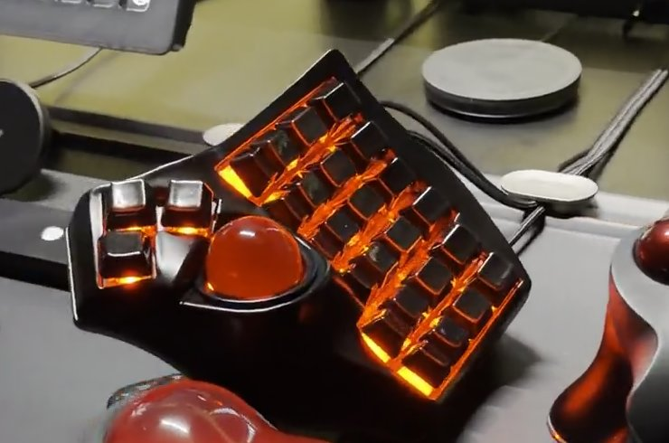
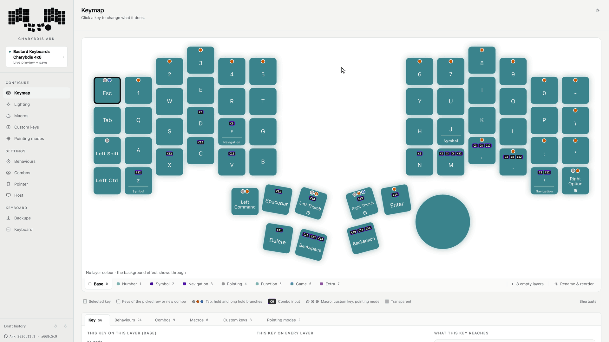
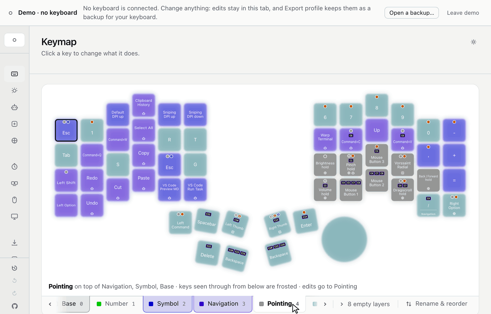
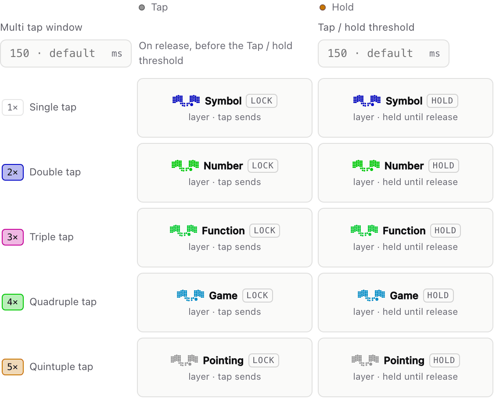
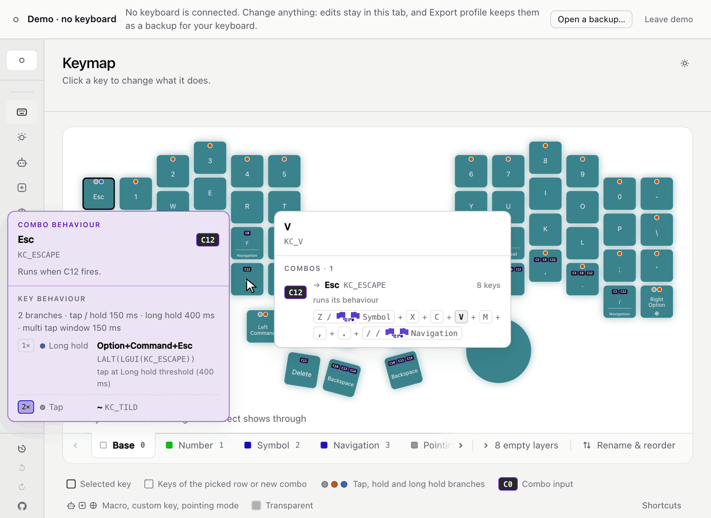

# Noah's Charybdis 4x6 firmware

QMK firmware for the [BastardKB Charybdis 4x6](https://bastardkb.com/), a
split keyboard with a trackball. The keyboard's profile (keymap, behaviours,
combos, macros, trackball and lighting) is stored on the keyboard itself and
is edited in [Charybdis Ark](https://github.com/NoahCLR/charybdis-ark), a web
editor. In Ark's default edit mode, a change takes effect from the next
keypress, with no reflashing.

It runs on a Charybdis 4x6 with an RP2040 controller and the trackball on the
right half, and editing needs Chrome or Edge.
[Before you flash](#before-you-flash) lists what to know first.

**Try it without a keyboard:** open <https://ark.ncleroy.dev> and choose
**Explore a demo**. It opens on an example profile close to the defaults, in
any browser on a computer. Every screen works; saving and live editing need a
keyboard.

<p align="center">
  
</p>

## Editing while you type

<p align="center">
  <picture>
    <source media="(prefers-color-scheme: dark)" srcset="docs/images/readme/live-edit-dark.gif">
    
  </picture>
  <br>
  <sub>Esc changed to Mute, reviewed, then reverted.</sub>
</p>

Double-click a key in Ark and pick what it should do. The next keypress uses
it, so the change can be tried in real typing before it is saved. Undo puts
the key back. **Revert**, or unplugging the keyboard, drops all unsaved
changes, and **Save to keyboard** stores them.

A change made while a key is held or a layer is locked waits until the key is
released or the layer unlocked. Before saving, Ark lists the changes and
warns if one could leave you stuck on a layer. If power is lost during a
save, the keyboard keeps either the old profile or the new one, never a mix.

This is Ark's default edit mode, **Live preview + save**. In **Live edit** the
keyboard saves 3 seconds after the last edit, and in **Review and save**
nothing changes on the keyboard until you save
([edit modes](https://github.com/NoahCLR/charybdis-ark/blob/main/docs/guide/review-and-save.md#edit-modes)).

## What the keyboard does

### Layers

A layer works like the Fn key on a laptop, except that any key can lead to
one. The default profile has Base, Number, Symbol, Navigation, Pointing,
Function and Game, plus Extra, left empty for your own keys. A layer key turns
its layer on while held, locks it on, or turns it on for the next key only.
Layers stack: a transparent key on a higher layer passes through to
the nearest active layer below it. Ark can show layers stacked this way, with
the keys from lower layers frosted.

<p align="center">
  <picture>
    <source media="(prefers-color-scheme: dark)" srcset="docs/images/readme/layers-dark.gif">
    
  </picture>
  <br>
  <sub>Symbol, Navigation and Pointing stacked in Ark.</sub>
</p>

### Behaviours

A key's behaviour sets what it does on a tap, a hold and a long hold,
separately for one to five taps. It belongs to the keycode rather than to a
position on the board: Esc behaves the same wherever Esc is placed.

The left thumb key locks Symbol on one tap, Number on two, and so on up to
Pointing on five. Holding on the last tap keeps the layer on only while the
key is held. A held number key types its shifted symbol, such as `!` for `1`.

<p align="center">
  <picture>
    <source media="(prefers-color-scheme: dark)" srcset="docs/images/readme/left-thumb-dark.png">
    
  </picture>
  <br>
  <sub>The left thumb key's behaviour in Ark.</sub>
</p>

### Combos

A combo sends something when several keys are pressed together. In the
default profile `D`+`F` is Tab, and Backspace+Enter sends the author's
VoiceInk dictation shortcut. A combo can use up to 16 keys; eight keys along
the bottom row pressed together send Esc.

If what a combo sends has a behaviour, the combo runs that behaviour too: the
bottom-row combo has Esc's double tap and long hold, and `N`+`M`, which sends
Command, gives Option when its second tap is held. In Ark, hovering a key in
such a combo opens a second card with that behaviour.

<p align="center">
  <picture>
    <source media="(prefers-color-scheme: dark)" srcset="docs/images/readme/combo-cards-dark.gif">
    
  </picture>
  <br>
  <sub>Hover cards in Ark for <code>V</code>, <code>N</code> and Enter.</sub>
</p>

Behaviours and combos can be switched off for the whole keyboard, one layer,
one behaviour or combo, or one key on one layer, without losing their
settings.

### Custom keys

Custom keys send shortcuts that no single keycode can, such as ones that mix
left and right modifiers (Left Ctrl+Right Option+K). A shortcut holds up to
six keys, which can include one media key, one system key and mouse keys, and
can turn layers on while held. Since a behaviour belongs to a keycode, a
custom key is also how one key gets a behaviour of its own: the right thumb
key is a custom key. A tap locks Navigation, a double tap is play/pause, a
double tap held briefly is Esc, and a triple tap skips to the next track.

### Macros

A macro can type text, press keys and pause. The default macros send shortcuts
set up on the author's Mac, for Spotlight, an AI chat, the terminal, clipboard
history and copying text out of a screenshot. Macros type through the
computer's keyboard layout, which keeps accented letters correct on a Dutch or
German layout. Emoji need Unicode entry on the computer; the [macros
guide](docs/guide/macros.md) explains it per system. A macro can also block
other keys while it plays.

### Trackball

Moving the ball turns on the pointer layer (Pointing in the default profile),
where `M` and `,` are left and right click. The layer turns off 1.2 seconds
after the ball stops, or at the first keypress after it stops. Modifiers, and
shortcuts such as Command+C, don't turn it off.

On that layer, holding `N` turns the ball into a volume control, and holding
`H` into a brightness control. Holding `J` makes the ball scroll with Command
held, which acts as pinch-to-zoom on a Mac with BetterMouse, and holding `.`
scrolls the page. A quick tap on `N`, `H`, `J` or `.` still types the
character.

Each of these is a pointing mode: it either scrolls, or sends a key, a mouse
button or a macro for each direction the ball rolls. It can have its own
pointer speed and can start automatically whenever a chosen layer is on. The
Undo / Redo mode, on a double tap held on Right Option, steps through
Command+Z and Shift+Command+Z as the ball rolls sideways.

Holding `F` turns on Navigation, which slows the pointer (sniping) for
precise cursor placement. Keys `2` to `5` on the Symbol layer step the normal
and slow pointer speeds up and down, and Ark shows the new value within about
a second.

### Lighting

Each layer above Base has its own colour: Number green, Symbol blue,
Navigation indigo. On most of them only the keys in use light up, over the
background effect. While a thumb key that leads to a layer is held, that
layer's keys light up before the layer turns on.

From the second tap, the half being tapped shows the colour of that tap
count, and the colour changes again when a hold starts, so a double tap is
visible before anything is typed. Combos and the running pointing mode light
up as well, and the pointer layer's lights fade out before it turns off.
After 10 minutes without input the lights go dark until a key is pressed or
the ball moves.

<div align="center">
<video src="https://github.com/user-attachments/assets/fb5749e2-6f30-44de-99d7-9bd47f94659a" controls width="360"></video>
<br>
<sub>Both halves running this firmware.</sub>
</div>

## Before you flash

- **Hardware:** BastardKB's Charybdis 4x6 with an RP2040 controller (the
  Splinky build). The trackball and the USB cable go on the right half;
  builds with the trackball on the left aren't supported.
- **Starting point:** the default profile, set up for a Mac with the Dutch
  layout and the author's app shortcuts. There is no blank profile, and your
  current keymap isn't carried over. On Windows or Linux, Ark's **Host**
  settings can swap Ctrl and Command, but the default shortcuts and macros
  are Mac shortcuts, so expect to change some of them.
- **Editor:** Ark, in Chrome or Edge. VIA isn't supported.
- **Taps that wait:** on a key that also has a double tap, a single tap waits
  out the multi tap window (150 ms by default) to see if a second tap
  follows.
- **For QMK users:** dual-role keys (`LT()`, `MT()`) follow the firmware's own
  tap and hold rules, described in [Keys](docs/guide/keys.md). Permissive
  Hold, Chordal Hold and Flow Tap aren't used, and tapping a dual-role key
  then holding it starts a new hold rather than repeating the tap. Nothing is
  tuned for home row mods. This build has no Caps Word, Leader or key
  overrides. Text replacement (autocorrect) is the firmware's own, not
  QMK's: when a word ends it fixes a typo, types longer text or plays a macro
  from the list in your profile
  ([Text replacement](docs/guide/autocorrect.md)).
- **Limits:** 16 layers, 128 behaviours with five tap counts each, 128 combos,
  128 custom keys, 128 macros and 32 pointing modes.
- **Updates:** flashing never erases the saved profile, but the keyboard runs
  it only if the new release has the same compiled defaults and firmware
  version (a number separate from the release name). Otherwise it starts from
  the new defaults, and importing a backup brings your profile back. A
  release with a new firmware version refuses older backups. Before
  updating, export a backup in Ark, read the release notes and keep the old
  release's `.uf2` files to go back to. Ark edits only firmware whose profile
  format it knows, so update both halves.
  [What happens to your profile](docs/guide/installing.md#what-happens-to-your-profile)
  has the details.
- **Recovery:** import a backup, use the recovery copy Ark stores in the
  browser before each save, or reset the keyboard to the compiled defaults
  ([Recovering](docs/guide/installing.md#recovering)).

## Get started

1. Download `bastardkb_charybdis_4x6_noah_right.uf2` and
   `bastardkb_charybdis_4x6_noah_left.uf2` from the
   [latest release](https://github.com/NoahCLR/charybdis-4x6/releases/latest).
2. Flash each half on its own: unplug the keyboard from the computer,
   disconnect the cable between the halves, then connect only that half by
   USB, double-tap its reset button and copy its file onto the `RPI-RP2`
   drive that appears. The
   `_right` file goes on the right half and the `_left` file on the left.
   Use both files from the same release.
3. Connect the halves and plug the right half into the computer.
4. Open <https://ark.ncleroy.dev> in Chrome or Edge, click
   **Choose keyboard…** and select the keyboard. In **Host**, set your
   computer's system and keyboard layout, so keys and macros type the right
   characters, and save. Then export a first backup from **Backups**.

## Changing the defaults in C

The compiled defaults are plain C data in the
[keymap folder](./keyboards/bastardkb/charybdis/4x6/keymaps/noah/), and the
runtime in [`users/noah/`](./users/noah/) loads them. The default Backspace
and the custom key behind the VoiceInk combo look like this:

```c
// keymap.c, key_behaviors[]
// Tap: Backspace. Hold: Option+Backspace. Long hold (500 ms): Command+Backspace.
{.keycode = KC_BSPC, .longer_hold_term = 500, .tap_counts = {[0] = {
    .hold      = TAP_ON_RELEASE_AFTER_HOLD(A(KC_BSPC)),
    .long_hold = TAP_AT_HOLD_THRESHOLD(G(KC_BSPC))}}},

// keymap.c, a row of CUSTOM_KEYS()
// A custom key that sends Left Ctrl+Left Option+Space.
SHORTCUT(CUSTOM_KEY_4, "VoiceInk", SHORTCUT_MODS(KC_LCTL, KC_LALT),
         SHORTCUT_KEYS(KC_SPC), SHORTCUT_NO_LAYERS)
```

The pair of files you flash is built with Docker against a fork of
BastardKB's QMK; `qmk compile` on its own builds an image that can't store a
profile. A pair built with changed defaults starts the keyboard from those
defaults. Layers are ordinary `LAYOUT()` arrays, and your own C goes into
hook functions that call the runtime's helpers.
[Authoring in C](docs/guide/authoring.md) and
[Hook overrides](docs/guide/hooks.md) have the details.

## Learn more

- [Firmware guide](docs/guide/README.md): what the keyboard does, part by part
- [Installing and recovering](docs/guide/installing.md): flashing, updates
  and recovery
- [Authoring in C](docs/guide/authoring.md): changing the compiled defaults
  or building your own pair
- [Ark's guide](https://github.com/NoahCLR/charybdis-ark/blob/main/docs/guide/README.md):
  one page per screen of the editor
- [Development](docs/development.md) and
  [architecture](docs/architecture/README.md): working on the firmware

The firmware is GPL-2.0; see [LICENSE](LICENSE).

## Thanks

The Charybdis is Quentin's open-source design from
[BastardKB](https://bastardkb.com/), and its hardware files are in the
[Charybdis project](https://github.com/Bastardkb/Charybdis). His design and the
community's mods made this build possible, and it has given me hundreds of
hours of good firmware and hardware tinkering. If you want to support him, buy
the hardware from [BastardKB](https://bastardkb.com/), not from a knockoff seller.
