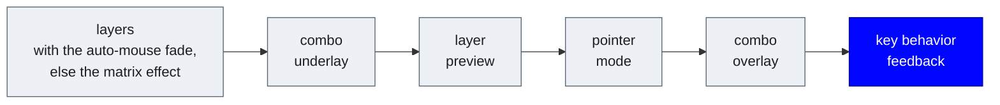
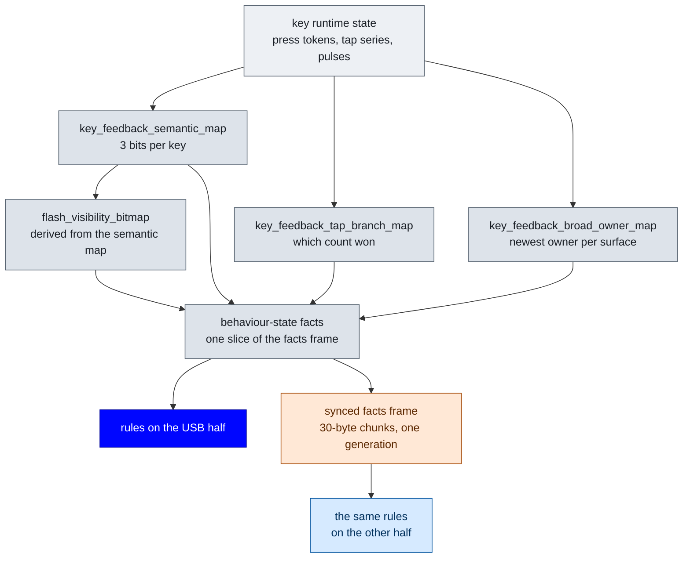
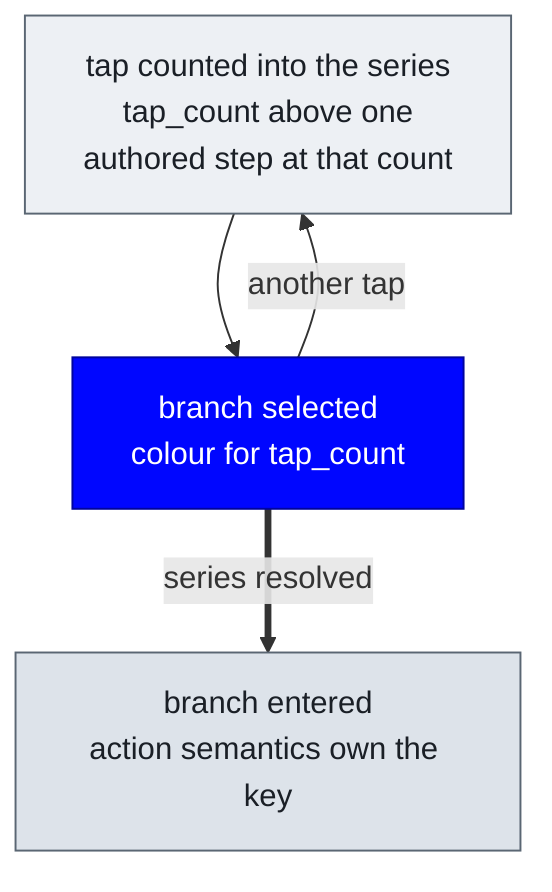
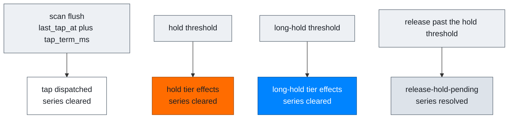
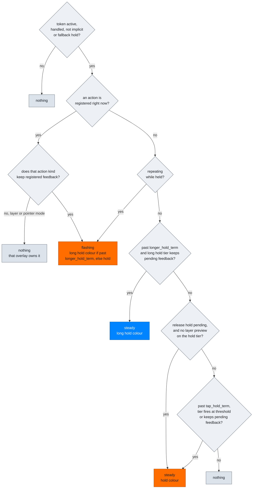

# RGB Implementation

What the code actually does, as distinct from what it is meant to do.
[rgbflow.md](./rgbflow.md) is the intended language; this is the machinery behind
it, including the places the two do not line up. For authoring colors, locality
and LED groups see [RGB_CONFIG.md](./RGB_CONFIG.md).

## Where the key-behavior rules sit

Lighting is one ordered rule list, resolved by the engine under
[`users/noah/lib/rgb/lighting/`](../users/noah/lib/rgb/lighting/) and specified
in [lighting rules](./architecture/lighting-rules-v1.md). The topmost rule that
paints an LED wins. The firmware's own lighting is **Standard lighting**, the
conversion of `rgb_config.c`, whose rules run, top to bottom: key-behavior
feedback (its specific groups, its all-states groups, then its main rule),
combo overlay, pointing mode, layer preview, combo underlay, then the layers
with the auto-mouse fade. Key-behavior feedback is on top, so it wins over
everything else wherever it paints.

`locality` becomes each rule's target. The authored profile uses
`RGB_KEY_HALF`, the subject's halves, so one key's feedback state repaints that
entire half, over the layer colors and pointer-mode overlay underneath.

## Individual Painting subjects

`fact_combo_held.c` reads identified active outputs from the centralized combo
origin adapter, preserving roles and quiet layer owners while ordering each
combo's own footprint newest first. `fact_behaviour.c` reads the key runtime's
captured row/slot/outcome records. A row id travels with branch resolution,
release effects and queued feedback, rather than being inferred from a current
keymap read. `paint_outcome.c` resolves supported layer/mode outcomes through
the existing thing tables. Fact 4/5 aggregate subjects and the compiled
Standard conversion are unchanged. The split frame appends these slices and
publishes the whole generation before either half renders it.

## Where the lighting program comes from

Each half holds one decoded lighting program in RAM
([`effective_rgb_runtime.c`](../users/noah/lib/profile/runtime/effective_rgb_runtime.c)).
Every profile publication rebuilds it from the published profile's RGB domain,
or from the compiled Standard lighting when the profile carries none, and moves
its generation. The compiled Standard lighting is built once
([`profile_rgb_compiled_v1.c`](../users/noah/lib/profile/schema/profile_rgb_compiled_v1.c)):
the `rgb_config.c` tables encoded as RGB domain version 4, converted by
[`profile_lighting_v1_convert.c`](../users/noah/lib/profile/schema/profile_lighting_v1_convert.c),
and validated like any profile's.

The renderer ([`rgb_runtime.c`](../users/noah/lib/rgb/core/rgb_runtime.c)) reads
only that program. At the first LED chunk of a frame that falls on its own half
it captures the facts and resolves the whole frame again only if the program
generation, the keymap, the facts or its LED range changed, a timing is due,
or something time-based is showing; otherwise the previous resolution stands.
Each chunk then writes the resolved colours of its own LEDs. A rule that
composes over the matrix effect finishes per chunk from the colours the effect
just drew. Diagnostics still win outright, and the RGB timeout still turns the
board off.

The engine names no kind. Facts, targets, paints and timings are registry rows
in [`profile_lighting_kinds_v1.h`](../users/noah/lib/profile/schema/profile_lighting_kinds_v1.h),
each with its own module under `lighting/kinds/` and compile flag, reached
through the switches generated in `lighting_dispatch.c`.

## How truth reaches the LEDs

Per-key truth is computed only on the USB half. The other half receives the
behaviour state as facts and runs the same rules on them, which is why the two
halves cannot disagree about the rules, only about freshness.

The semantic, tap-branch and broad-owner maps visit only the reducer's active
press-token and tap-series slots, using its existing active bitmaps. Slots stay
in ascending matrix order, with the pulse considered before tap series and
press tokens, preserving semantic priority and owner tie-breaking. Pulse
expiry and queued-pulse promotion run even when both active bitmaps are empty:
a released key can still own visible feedback. RGB and split update cadence
remain unchanged.

`mark_key_feedback_dirty()` marks the lighting facts frame. It fires when a
transition plan is non-empty, or when a plan was empty but
`next_feedback_sequence` moved, checked on the press, release and scan entry
points. The behaviour slice is the frame's one gated slice: the USB half
rebuilds it while it is dirty, while it is away from rest, on a heartbeat or a
forced pass, so an active-to-rest edge is never missed. Only the chunks that
changed are sent; the last chunk of a pass commits it, and a pass that fails
part-way publishes nothing and is resent whole.

## The tap phase runs on no clock

Both tap-phase questions collapse into one predicate,
`key_feedback_tap_series_shows_tap_branch`: the series is active, its count is past
the base one, the row authors a step at that count, and the series has not resolved.

There is no derived settle moment, so there is nothing to anchor and nothing to
disagree with the engine about. `tap_branch_map` carries `series->tap_count`, which
the reducer sets from `token->interaction.selection.tap_count` — the resolved
branch index, not the raw press count, so the colour names the branch that would
actually win. `tap_branch_has_authored_step` keeps it to branches the row really
authors, since the colour table would otherwise clamp a colour onto a count with
no step behind it.

## The action phase resolves where it is decided

There is no window between deciding a branch and doing it. Each resolution point
acts immediately:

A release before the hold threshold does not resolve anything on a multi-tap row:
it preserves the chain so the multi-tap window can run out, which is what gives
every authored depth — the deepest included — the same visible window before its
action lands. `terminal_tap_only_feedback_window` in the release planner is the
condition that extends that to terminal branches.

## Tier semantics are decided in order

`key_feedback_semantic_for_token` walks these checks top to bottom and returns on
the first match. This is the whole of the hold and long-hold vocabulary.

`keeps_registered_feedback` comes from the action kind table. It is true for
`LITERAL`, `MACRO`, `QMK_BEHAVIOR`, `QMK_FUNCTION` and `CUSTOM_KEY`, and false for
every layer and pointer-mode kind and for unassigned userspace codes. That single flag is why a held modifier flashes and a held
momentary layer does not.

Pulses are a separate one-shot channel lasting one
`FEEDBACK_FLASH_HALF_PERIOD_MS`, with a queue slot so a second pulse arriving
during the first re-arms rather than being dropped. `TAP_COMMITTED` renders green,
`HOLD` renders as steady hold colour, `LONG_HOLD` as steady long-hold colour.

## Precedence

When one key has more than one live semantic, the highest wins.

| Priority | Semantic |
| --- | --- |
| 60 | tap committed |
| 50 | long hold active, steady or flashing |
| 40 | hold active or hold pending |
| 10 | tap branch pending |

The branch sits at the bottom deliberately: it names which branch is selected,
which every action state may replace with what that branch is about to do. A branch
that authors nothing nameable keeps the key because nothing outranks it.

## Deliberate silences

The behaviour fact producing no subject leaves the rules beneath showing, so
these are silences of the override, not of the LED.

- branch 0, always: the non-tapping surface
- a tap count with no authored step, which would otherwise take a clamped colour
- layer and pointer-mode actions, whose own overlays are the persistent feedback
- any hold tier carrying a layer preview, which routes to the preview rules
- base-tap commits, limited by `tap_commit_mode`
- implicit-hold and fallback-hold tokens, which are holds the engine synthesised
  rather than behaviour anyone authored
- a selected branch inside a held combo's footprint: the behaviour fact reads
  the frame's combos slice, so both halves drop it from the same facts

## Where this does not match rgbflow.md

0. **Colours are read against a lit board, and one of them barely is.**
   `hold_active_color` `HSV(18)` `#FF6C00` sits 25 degrees from the base layer's
   resting red `HSV(0)` `#FF0000` at equal saturation and brightness. The base layer
   carries most of the board's hold feedback, so the most common hold colour is the
   one least separable from what it paints over.

1. **The palette has homonyms.** Three feedback colours are byte-for-byte identical
   to a layer colour: branch 2 `#0006FF` is `LAYER_SYM`, branch 4 `#00FF00` is
   `LAYER_NUM`, and the tap colour `#FFFFFF` is `LAYER_POINTER`. Because the layers
   paint mapped keys only and this feedback repaints the whole half, the signal is
   degraded rather than lost — the pressed key holds still while its neighbours
   move. The branch colours are also on screen for longer than they used to be,
   so these collisions are more visible than before rather than less.

2. **Scale is out of proportion to scope.** `RGB_KEY_HALF` repaints half the board
   for a single key's state, and its rules sit on top, so it overrides the
   layer and pointer-mode colours underneath while it is active.

### Closed by the single-state tap phase

- The count colour is no longer overloaded: one predicate, one meaning.
- Display and action can no longer describe different moments, because the display
  reads the action state instead of a parallel clock.
- The action-delay window is gone entirely, so there is no longer a term whose only
  job was to make the colour visible.
- The second tap-phase colour is gone, so the phase can no longer show two
  different things about one moment. The collisions it had did not close: they moved
  with the palette, and `tap_committed` is now itself exactly `LAYER_POINTER`
  `#FFFFFF`. That is a palette choice, not a consequence of the collapse.
