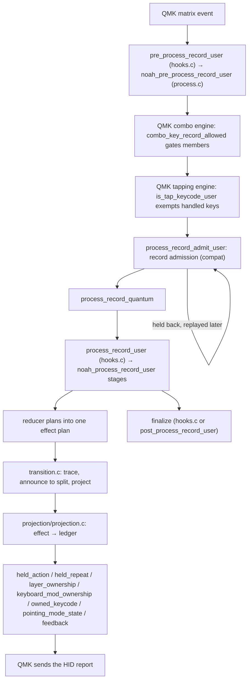

# A key press, from the QMK hook to the report

How one physical key event crosses the userspace on the master half: which
module owns each fact, where each decision is made and what holds the whole
path together. The reducer's own state and ownership map are in
[`key/runtime/README.md`](../../users/noah/lib/key/runtime/README.md); record
admission and combo origins are in
[`compat/README.md`](../../users/noah/lib/compat/README.md). What a person
authoring keys sees is in [What keys can do](../guide/keys.md).

The rule: **planners decide, projection applies, adapters adapt.** The reducer
plans effects into one plan; `transition.c` projects them into the ledgers;
QMK-facing adapters translate QMK's records and queues without deciding
anything about a key.

## The path

`hooks.c` holds weak `*_user` defaults that call the `noah_*` helpers in
`noah_runtime.h`; a keymap that overrides one chains back into it.
`process_record_user` calls finalize itself when it returns false. When it
returns true, QMK runs the rest of `process_record_quantum()` (BK's
`process_record_kb()` tail, then QMK's own features such as RGB, one-shot and
`process_quantum`); `post_process_record_user` finalizes only if every one of
them returns true too, since `process_record()` skips post-processing on
false.

## Who owns which fact

| Fact | Owner | Written by |
| --- | --- | --- |
| Press identity, tap series, leases, locks, pending releases, shadow projection | `key_runtime_core_state_t` (`key/runtime/reducer/`) | the reducer only |
| Release, scan and tap-series decisions | `key/runtime/planning/` | planners, returning effects and settlements |
| Whether a record uses its behaviour row or joins a combo | `key/behavior/participation.c` | pre-process capture, delivery in `is_tap_record_user` and process |
| Records held behind an undecided key | `compat/qmk_record_admission.c` | admission only; it decides nothing about a key |
| A combo output's owner key, footprint and participation | `compat/qmk_combo_origin.c` → `slot/origin_registry.c` | compatibility only |
| Applied layers (momentary owners, locks, one-shot) | `state/ownership/layer_ownership.c` | projected effects and layer actions |
| Modifier refcounts: physical, report, managed | `state/ownership/keyboard_mod_ownership.c` | pre-process (physical), finalize (report), held actions (managed) |
| Literal report usages | `action/owned_keycode.c` | taps, held-action leases, finalize |
| Held actions and repeats | `key/ownership/held_action.c`, `held_repeat.c` | projected effects; repeats tick in housekeeping |
| Pointing mode state | `pointing/runtime/pointing_mode_state.c` | the pointing runtime |
| Feedback pulses | core state, via `projection/feedback_projection.c` | projected effects; `feedback.c` reads them for lighting and split |
| The HID report | QMK | only at aggregate 0→1 and 1→0 transitions of a ledger |

## A press

1. **Pre-process** (`noah_pre_process_record_user`), before combos see the
   record: a press during uninterruptible playback is dropped
   (`noah_record_admission_macro_admit`); a press of a key without a behaviour
   first settles other keys' pending layer-changing taps
   (`noah_key_runtime_settle_layer_taps_before_press`) and re-resolves its
   keycode; its participation is stored against its source layer; the combo
   adapter observes the physical member; `keyboard_mod_ownership` counts a
   physical modifier.
2. **Combos and tapping.** QMK's combo engine may buffer the press or replace
   it with a `COMBO_EVENT`. Every handled key is exempt from QMK's tapping
   engine, so it passes straight on.
3. **Admission.** While a key whose hold changes other keys is undecided
   (D-F03, D-F27), the record is held and replayed later through
   `process_record()` with its physical timestamp.
4. **Process stages** (`noah_process_record_user`). First, for every record:
   QMK's auto-mouse lock is taken back and the combo origin is normalized
   (`noah_qmk_combo_origin_normalize_record`). Then, for a physical record
   only (a synthetic one skips this): participation is settled for delivery,
   `key_runtime_preflight_settle_before_release()` runs (below), and the
   reducer observes the event
   (`key_runtime_core_observe_process_record_event_with_row`), allocating the
   press token. Then, in order, each stage may end processing:
   `synthetic_passthrough` → `preflight` → `release_slot_keycode` →
   `handled_key` → `non_handled_release_cleanup` → `direct_action` →
   `native_overlap` → `idle_custom_key`.
5. **Preflight** (`preflight.c`): the reducer's moment before a press,
   `key_runtime_core_settle_before_press()`, on a streaming plan: other active
   keys catch up missed scans, register due fallback holds and settle as taps
   (class 3 of D-F27); then pending tap series it ends are typed (a handled
   press ends only tap/hold keys' series; any other press ends all).
6. **Handled press** (`press.c`): `key_runtime_core_handle_handled_key_press()`
   plans into a buffered plan: flush a series the press cannot continue, unlock
   a pointing mode the key itself has locked, join the tap series, turn on a
   momentary layer, register a hold that goes on at the press. Planning returns
   before `key_runtime_transition_execute_event_plan()` projects.
7. **Unhandled press**: `direct_action` dispatches layer and pointing locks,
   `TO()` and macros; `native_overlap` keeps a usage another owner holds
   without a second edge; `idle_custom_key` swallows a custom key with neither
   shortcut nor row; the rest go to QMK's default action.
8. **Finalize** (`noah_process_record_user_finalize`): credit report
   ownership to a press QMK processed, end the pointing mode's modifier mask,
   use up a one-shot layer by QMK's rule (MT excepted: its release planner
   plans `KEY_RUNTIME_EFFECT_LAYER_ONESHOT_CONSUME`), settle auto-mouse.

## A release

1. Normalization and participation as for a press; a combo output's release
   pairs with its completion (`compat/README.md`).
2. `key_runtime_preflight_settle_before_release()` runs before the reducer
   observes the release: the key first plans the holds it missed while its
   press waited in admission, then, if it holds a layer or modifiers
   (`key_runtime_core_release_is_mods_or_layer()`), settles other keys
   (D-F27, "Releases that wait"): they catch up missed scans and settle as
   taps, as at a press, but a release registers no fallback hold; only a press
   does (`key_runtime_core_interrupt_active_keys_on_other_press()`).
3. The reducer observes the release by position. Preflight drops a native modifier release while another owner
   still holds that modifier (`keyboard_mod_ownership_should_suppress_default`),
   still retiring the token's leases. Stage `release_slot_keycode` swaps in
   the token's `resolved_keycode`, so a layer change while held cannot change
   the key.
4. `release.c`: `key_runtime_core_handle_handled_key_release()` tries the
   pending tap series, then the active press, then plans an unmatched release
   for a handled keycode. The release planner returns a settlement; the reducer
   applies it to the series (start, preserve, end) and appends the effects.
5. `deferred_release.c` moves dispatches blocked by another key's live tap into
   the pending-release queue, unchanged. The plan is projected, and only after
   the release helper returns does `key_runtime_deferred_release_drain_dispatches()`
   run.
6. A non-handled release retires the token and its leases
   (`key_runtime_core_finalize_non_handled_release`); finalize retires its
   report counts.

## The scan

`noah_matrix_scan_user()` runs on the master half only (the slave half runs
just the durable-I/O grant), in this order:

1. `noah_profile_store_runtime_matrix_scan()`: the durable-I/O grant.
2. `noah_qmk_combo_origin_scan()`: retire suppressed or expired completions.
3. `noah_key_runtime_scan()`. While a token or tap series is live,
   `key_runtime_core_scan()` on a streaming plan visits active tokens
   (threshold hold and long hold, a hold that waits for release, fallback
   holds) and pending tap series (window expiry flushes the delayed tap, a
   pending series' holds). Then, if there was core work or a dispatch is
   queued, the pending-release queue drains up to four records: each time the
   oldest record whose owner key is no longer down, so a record behind a
   still-held owner can go first. The pointing mode's DPI sync runs every
   scan.
4. `noah_record_admission_task()`: replay held records once nothing is
   undecided, so a hold reached this scan applies before the keys it held
   back. Back-to-back replay has no scans between records, which is why
   preflight plans missed scans
   (`key_runtime_core_plan_missed_scans_for_token()`).
5. Macro playback, then split runtime sync.

`housekeeping_task_user` ticks held repeats.

## From an action to the report

Taps (projected dispatches, delayed taps, repeats, direct actions,
pointing-mode outputs) go out through `noah_emit_*`
(`action/action_dispatch.c`). When its emit policy says so
(`settle_pending_fallback_holds`; `NOAH_EMIT_POLICY_NONE` does not), it first
settles every key whose fallback hold is due
(`noah_key_runtime_settle_pending_fallback_hold()` in `api.c`, which holds no
plan because it runs beneath another plan's projection). Held actions call
`noah_action_press` and `noah_action_release` directly, or take an
`owned_keycode` lease, with no settle. In `action_lifecycle.c`,
`noah_action_tap_at` and `noah_action_press` try a macro first;
`noah_action_press` and `noah_action_release` offer a pointing keycode to the
pointing runtime; then each dispatches by action kind
(`action_kind_registry_list.h`): literals through `owned_keycode`, which
registers with QMK only on a usage's first owner and unregisters on its last;
modifiers through `keyboard_mod_ownership` (QMK's `register_mods` is
overridden in `compat/qmk_mod_contract`); layer keycodes through
`layer_ownership`; other QMK behaviours as a synthetic record, which re-enters
QMK's processing and passes stage `synthetic_passthrough`. A custom key
sent as an action sends only its shortcut (`owned_keycode_tap_parts`), and a
held one keeps its shortcut through its held action's lease (D-F26). A delayed
tap replays the modifiers it was planned under
(`keyboard_mod_policy_begin_action_replay`); every save, mask and replay of
modifier state goes through `state/modifiers/keyboard_mod_policy.h`.

Report ownership is settled after behaviours had their turn: a press they
consumed owns no native usage, so it cannot hold a managed owner's usage
down. Finalize credits a press QMK processed; `native_overlap` credits a press
whose redundant edge it suppressed; every credited release retires its owner.

## Pointing modes: where keys enter the pointing runtime

- **No offer.** A pointing mode takes no key press: mouse buttons run their
  own behaviour in every mode (D-F62 retired the button overrides), and a
  mode's own keys come from its linked layer, an ordinary layer.
- **Masking.** Around each key event, the active mode's own modifiers are
  masked (`key_runtime_process_begin_keyboard_event_mod_mask`).
- **Effects.** A held pointing keycode reaches `pointing_mode_handle_keycode_press_at()`
  through `noah_action_press`; lock taps and lock states go through
  `projection/pd_projection.c`, which first unregisters any other mode's held
  action, since one mode runs at a time.
- **The bridge back.** `pointing_mode_state.c` reports a changed local lock
  through `pointing_mode_key_runtime_bridge_observe_local_lock_state()`, the
  only way the pointing runtime writes into the reducer's shadow state.
- **Layers.** A layer change from a key reaches the pointing runtime through
  QMK's layer-state hook, where linked layers start and end their modes; a
  mode its key runs brings its linked layer through `layer_ownership`, as one
  more owner (D-F62).

## Invariants that span files

- **Identity is the physical position**, never the visible keycode: tokens,
  series and leases are keyed by `keypos_t`, and a release resolves by
  position.
- **Physical time, delivery clock.** Tokens keep physical press and release
  times (`noah_qmk_gesture_event_time`); the reducer's clock stays at delivery
  or scan time (D-F01).
- **One hold gate.** Hold progress goes only through
  `key_runtime_core_press_token_hold_eligible()`: a release already queued in
  QMK or admission ends the gesture at its physical time.
- **One plan at a time.** Planning returns before projection, and no frame
  holds a plan beneath another plan's projection (plan kinds:
  `key/runtime/README.md`).
- **Ledgers do not mint leases.** Writes back into the reducer are exactly
  `layer_ownership_set_lock_state()` and the one-shot layer
  (`key_runtime_core_layer_lock_set`, `key_runtime_core_layer_oneshot_set`)
  and the pointing bridge; `run_feature_gate_compile_tests.sh` enforces both.
- **No raw report writes.** Only `owned_keycode.c` and the action-dispatch
  boundary call QMK's register and unregister; `run_owned_keycode_tests.sh`
  rejects other callers.
- **Synthetic records bypass the physical runtime**: admission and the reducer
  ignore them.

## Where a change goes

- What a key does: its `key_behaviors[]` row in the profile's `keymap.c`;
  what a row can mean: `key/behavior/`.
- Release, quick release, fallback or tap-series semantics:
  `key/runtime/planning/`, with reducer support if state changes;
  `release.c`, `deferred_release.c`, lighting and split only carry decisions.
- Scan-time holds and window expiry: `planning/scan_planner.c` and
  `planning/tap_series_flush.c`.
- How an effect is applied: `key/runtime/projection/`; a planner never writes
  a ledger.
- Layer locks and momentary layers: `state/ownership/layer_ownership.c`; a
  new owned layer keycode is a matcher in `action/action_kind.c`, and where an
  action may be placed is one rule, `noah_action_supported_at()`.
- Combo origins and footprints: `compat/qmk_combo_origin.c` and
  `slot/origin_registry.c`, never a combo special case in the reducer.
- Hook wiring: `hooks.c` and `runtime_init.c`.
- A fact a module needs: a query in `reducer/state_query.c` or a projection
  snapshot, never a copy of the state.

## The one tap key QMK still decides

`TT()` or `OSL()` to a layer from 16 to 31 is not runtime-handled, so QMK's
tapping engine classifies it (`is_tap_keycode_user`). Keymap validation and
Profile Wire refuse it; for it alone `get_tapping_term()` and
`get_quick_tap_term()` (`compat/qmk_portable_profile.c`) answer with the
dual-role setting (D-F47) and `compat/qmk_gesture_timing.h` reads QMK's
tapping queue.

## Tests that hold it

- Reducer, planners, projection: `run_key_runtime_scenario_tests.sh`,
  `run_key_runtime_release_matrix_tests.sh`,
  `run_key_runtime_integration_harness_tests.sh`,
  `run_pending_release_queue_tests.sh`, `run_tap_depth_eight_tests.sh`.
- Leases against the applied ledgers: `run_key_runtime_modifier_hold_integration_tests.sh`,
  `run_key_runtime_physical_ownership_integration_tests.sh`,
  `run_key_runtime_layer_lock_integration_tests.sh`,
  `run_real_profile_thumb_layer_lock_integration_tests.sh`.
- Pointing keys, linked layers, the bridge and admission: `run_pointing_mode_key_runtime_integration_tests.sh`.
- The real QMK combo and tapping engines, delayed records and the hold-gate
  guard: `run_qmk_gesture_pipeline_tests.sh`.
- Adapters: `run_qmk_combo_origin_tests.sh`, `run_participation_tests.sh`,
  `run_qmk_contract_checks.sh` (fork hook order and record layouts).
- Ledgers: `run_owned_keycode_tests.sh`, `run_keyboard_mod_ownership_tests.sh`,
  `run_held_action_tests.sh`, `run_layer_ownership_tests.sh`.
- Wiring: `run_hook_chaining_tests.sh`, `run_runtime_init_order_tests.sh`,
  `run_feature_gate_compile_tests.sh`, `run_runtime_debug_tests.sh`,
  `run_runtime_trace_tests.sh`.
