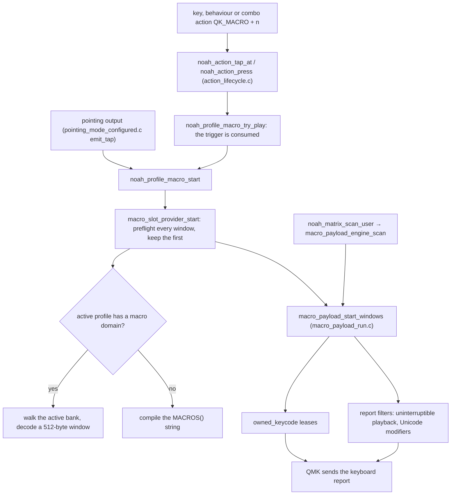

# Macro playback, from the action that starts it to the report

How a macro plays on the master half: what starts it, where its steps come
from, how they become key presses through the host layout or Unicode entry,
and how uninterruptible playback keeps the person's typing out of it. The bank
and its steps are [the macro domain](../spec/profile-wire-v1/macro-domain.md);
the host settings word is [settings](../spec/profile-wire-v1/settings-domain.md#scalars)
scalar 27; the layouts are [host layouts](../spec/host-layouts-v1.md). How the
action reaches `noah_action_*` is [key-press.md](key-press.md#from-an-action-to-the-report).
The engine's own state is in [`macro/README.md`](../../users/noah/lib/macro/README.md).

The rule: **one macro plays at a time, from the scan, through leases.** A
trigger only starts playback; every key the macro sends is a lease on the
owned-keycode ledger, taken and given back by the scan-driven engine.

## The path

## Starting a macro

- **Keys, behaviours and combos.** The macro action kind carries the macro
  preflight dispatch flag (`action_kind_registry_list.h`), so a
  `QK_MACRO + n` action reaching `noah_action_tap_at` or `noah_action_press`
  goes to `noah_profile_macro_try_play` before any other dispatch. A macro on a key without a behaviour is
  a direct action (`key_runtime_process_direct_action_key` in `preflight.c`);
  on a behaviour it is one tier's action. A macro is press-only: its release
  sends nothing.
- **The trigger is spent either way.** `try_play` returns true whatever the
  start returns: a busy engine, an empty slot or a macro that fails its checks
  plays nothing, and nothing is queued.
- **Pointing outputs** (D-F23) call `noah_profile_macro_start` after
  `noah_key_runtime_settle_pending_fallback_hold()`, and its result decides
  whether a once-per-movement movement is spent.

## Finding the macro

A macro plays from the active profile in windows, never copied whole (D-F59).
`profile_macro_provider.c` answers for the 128 macro slots and holds their
one-byte metadata (unchecked, valid, invalid), `profile_macro_slots`;
`macro_slot_provider.c` owns the one shared window of IR,
`macro_slot_active_ir`.

1. When `noah_active_profile_keymap_macros_publication()` has moved since the
   last start, every slot becomes unchecked and the cached slot offset is
   dropped. Activation happens only at a safe boundary, which waits for the
   engine to be idle and hold nothing (`profile_activation_policy.c`), so no
   playback spans two profiles.
2. When the active profile is not the compiled defaults and holds a macro
   domain (`noah_active_profile_macro_bank_is_live`), the provider walks the
   bank's terminators 32 bytes at a time to the slot's start and decodes a
   window from there (`macro_payload_decode_qmk_window`).
   Otherwise it compiles the slot's authored `MACROS()` string
   (`macro_payloads`) into one window.
3. **Preflight, before any output.** `macro_payload_preflight_begin` latches
   the host; `macro_slot_provider_compile` then decodes every window and
   checks each against it, carrying held-key balance across windows, and
   reloads the first. A decode failure marks the slot invalid until the next
   publication; a preflight refusal does not, since it depends on host
   settings.
4. `macro_payload_start_windows` starts the engine. When a window ends with
   more to come, `load_next` refills the same buffer from the saved cursor,
   reusing the slot offset found by the first window.

## Playing

`macro_payload_engine_scan` runs in `noah_matrix_scan_user` after record
admission, on the master half only. It does one bounded transition per scan;
a wait is a wrap-safe elapsed check, never a blocking delay.

| Macro step | What the engine does | Pace |
| --- | --- | --- |
| text | each character through the latched layout, below | press held and gap after: the slot pace `NOAH_MACRO_SLOT_DELAY` (default `TAP_CODE_DELAY`); a dead key's second stroke is held `TAP_CODE_DELAY` |
| chord | one lease per key, all released together | `TAP_CODE_DELAY`, or `TAP_HOLD_CAPS_DELAY` when the last key is Caps Lock |
| press, release | takes or returns a lease kept until the matching release | `TAP_CODE_DELAY` after |
| delay | waits | the delay plus `TAP_CODE_DELAY` |

The last window ending with every hold released finishes the macro; anything
else is a runtime error. Cleanup, after an error or `macro_payload_engine_cancel`,
releases one lease per scan, unwinds a Unicode entry in progress, then calls
the provider's finish, which frees the window. Cancellation comes from
`noah_eeconfig_init_user` and from invalidating the playing slot while another
window follows; invalidated during its last window, the slot is only marked
stale, plays out, and becomes unchecked at finish.

## Typing through the host layout

D-F16. `macro_payload_host_resolve` reads scalar 27: the layout id (an unknown
id types as US), the host (a manual choice, else QMK's detection through
`noah_host_effective` in `compat/qmk_host.h`, where unknown and iOS stay
unknown), and the ISO flag, which counts only on a macOS layout. All three are
latched for the whole macro.

`host_layout_lookup` gives a character one stroke, or a dead key then a
second stroke. A stroke is its key with Left Shift and Right Alt (AltGr,
Option on macOS) as the layout needs, each a lease; an ISO Mac exchanges
`KC_GRV` and `KC_NUBS`. ASCII and non-ASCII text both type this way, so text
follows any modifier the macro holds and never needs the host's Unicode setup.

## Unicode entry

D-F15. A character the layout cannot type uses Unicode entry when it is
available, otherwise preflight refuses the macro. It is available on macOS
when the layout is Unicode Hex Input or US with bit 8 set, and on Windows and
Linux when bit 8 is set; the hex digits, and `u` off macOS, must each be one
stroke on the layout. Preflight also refuses a non-modifier key held across
such a character.

| Host | Sequence (`macro_payload_start_unicode`) |
| --- | --- |
| macOS | hold Left Option, four hex digits per UTF-16 unit |
| Windows (WinCompose) | Right Alt, `u`, a leading `0` before an initial A–F, four to six digits, Enter |
| Linux | Ctrl+Shift+U, four to six digits, Space; Caps Lock toggled off and back when on |

`keyboard_report_mods_override_user` sets each report's modifiers to the
entry's own, leaving live physical, managed, weak and one-shot state
untouched. Entry settles 10 ms once started (Option down; Right Alt then `u`;
Ctrl+Shift+U); the other taps go at the slot pace. Then one neutral report,
then the live modifiers return. Cancelled, entry sends Escape (not on macOS),
restores Caps Lock and sends neutral, 10 ms apart; text already inserted
stays. The host must have the entry method set up and active; the keyboard
cannot check.

## Uninterruptible playback

D-F17. A macro plays uninterruptibly when its protection step says on, or,
without one, when preflight found a character that needs Unicode entry.

- **Input.** `noah_pre_process_record_user` asks
  `noah_record_admission_macro_admit` first, before combos and tapping. A new
  physical press during uninterruptible playback is dropped and its position
  marked (`macro_input_guard.c`); its release is dropped too, even after
  playback ends. Releases of keys pressed earlier and synthetic records pass. The marks
  clear at boot (`noah_record_admission_reset`).
- **Output.** At start a neutral report goes out, then a 10 ms settle.
  Throughout, `keyboard_report_keys_filter_user` (and the NKRO filter) puts
  only the macro's own lease usages in the outgoing copy and the modifier
  override only its lease modifiers. These are BK's report-copy hooks
  (`QMK_REPORT_KEYS_FILTER`, `QMK_REPORT_MODS_OVERRIDE`); live ownership keeps
  processing releases. Every macro lease change sends a report, so the
  macro's key gets its own edge even when the ledger already held that usage.
- **End.** After cleanup, the usages still held live are captured as
  suppressed, a neutral report goes out, playback stops being
  uninterruptible and the live modifiers return. A suppressed usage stays out of the report until its owner
  releases it; a later macro may still send it.

Pointing, consumer and system reports are outside it. Played interruptibly, a
usage another owner holds gains no fresh edge from the macro.

## The report

Every key a macro sends is an `owned_keycode` lease (`owned_keycode.c`): QMK
registers a usage on its first owner and unregisters it on its last, so a
macro never lifts a key someone else holds, and a physical release never cuts
the macro's own key short.

## Custom-key shortcuts are not playback

A custom key's shortcut (D-F26) is the key's own action, sent in the key
event through `owned_keycode_tap_chord` or a held action's lease; it plays no
steps and never reaches `macro/`. Its path is
[key-press.md](key-press.md#from-an-action-to-the-report).

## Where a change goes

- Step grammar: `macro_payload_decode_qmk.c` (bank bytes) and
  `macro_payload_parse.c` with `macro_payload_keycodes.c` (authored strings),
  with the [macro domain](../spec/profile-wire-v1/macro-domain.md).
- Pacing, Unicode entry, uninterruptible output: `macro_payload_run.c`; the press guard:
  `macro_input_guard.c`.
- Where bytes come from, and slot metadata: `profile_macro_provider.c`; the
  shared window: `macro_slot_provider.c`, inside the macro RAM policy of
  [resource-policy.md](../spec/resource-policy.md).
- Layouts: the fixture and its generator
  ([host-layouts-v1.md](../spec/host-layouts-v1.md#changing-the-data)), never
  `host_layout_tables.c` by hand.
- Default macros: `MACROS()` in `keymap.c`, then regenerate
  `authored_macro_bank.h` (`AGENTS.md`).

## Tests that hold it

- Steps, windows and preflight: `run_macro_payload_tests.sh`,
  `run_macro_payload_engine_tests.sh`, `run_macro_program_size_tests.sh`.
- Slot metadata and the shared window: `run_macro_slot_provider_tests.sh`;
  the active profile's bank: `run_profile_keymap_macros_runtime_tests.sh`.
- Leases, uninterruptible playback and report filters: `run_macro_output_ownership_tests.sh`,
  `run_qmk_report_filter_tests.sh`, `run_owned_keycode_tests.sh`.
- Host layouts against their sources: `run_host_layout_tests.sh`.
- Starting from actions: `run_action_lifecycle_tests.sh`,
  `run_action_dispatch_tests.sh`; from pointing outputs:
  `run_pointing_mode_handlers_tests.sh`; the press guard:
  `run_pointing_mode_key_runtime_integration_tests.sh`.
- The safe boundary waiting for playback: `run_profile_activation_policy_tests.sh`.
