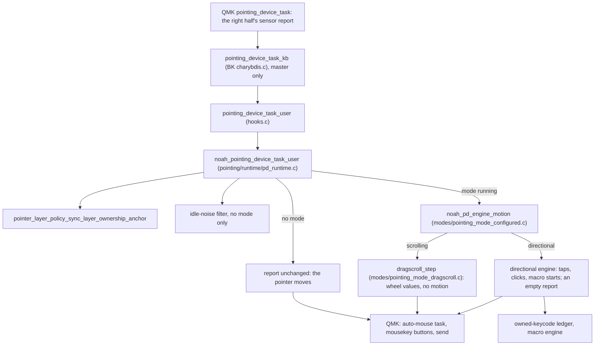

# The pointer report, from the sensor to the host

How one trackball report crosses the userspace on the master half: where the
running pointing mode turns it into scrolling or directional actions, how the
pointer layer and DPI follow, and how the slave half learns what runs. What a
mode does (activation, locks, linked layers, movements, outputs, the pointer
layer and DPI order) is the contract in
[pd-mode-domain-v1.md](../spec/pd-mode-domain-v1.md); the packet is
[split-activity-sync.md](../spec/split-activity-sync.md#runtime-state-packets).
How keys reach the pointing runtime is
[key-press.md](key-press.md#pointing-modes-where-keys-enter-the-pointing-runtime);
how its state is drawn is [rgb-render.md](rgb-render.md). The module's own
layout is in [`pointing/README.md`](../../users/noah/lib/pointing/README.md).

The rule: **`pointing_mode_state.c` decides which mode runs, one engine turns
motion into output for every pointing slot, and QMK keeps the report and
auto-mouse, steered from outside.**

## The path

BK's `pointing_device_task_kb` calls the user hook only on the master half,
after its own drag-scroll, which this userspace never turns on. QMK runs
`pointing_device_task_auto_mouse` on the returned report, merges mousekey
buttons (where owned clicks land) and sends.

## One report

1. **Anchor first.** QMK's auto-mouse looks at its timeout right after the
   hook, so `pointer_layer_policy_sync_layer_ownership_anchor` gives a pointer
   layer that `layer_ownership` holds or locks one count on QMK's key tracker
   before it does.
2. **Idle noise.** With no mode and no buttons, a report of at most
   `NOAH_POINTING_IDLE_NOISE_SUPPRESSION_ABS_MAX` counts after the quiet
   windows in `users/noah/config.h` is zeroed, so sensor drift cannot wake the
   pointer layer.
3. **The mode.** `pointing_mode_local_active_snapshot()` names the running mode;
   none passes the report on. Otherwise `noah_pd_engine_motion` runs the
   pointing slot `noah_pd_engine_enter` latched from
   `noah_active_profile_pd_for_mask`. Scrolling
   returns the report with x and y zeroed and wheel values set. Directional
   sends its outputs through `emit_tap` and returns an empty report. Every
   mode runs this one engine (D-F45, D-F49); there are no per-mode handlers.
4. **Outputs.** `emit_tap` sends key taps through `noah_emit_literal_tap*`,
   clicks through `noah_emit_owned_click` after dropping the report's pending
   motion (`noah_qmk_contract_pointer_drop_pending_motion`), and macros through
   `noah_profile_macro_start` ([macro-playback.md](macro-playback.md)). None
   goes through QMK's key processing.

## Which mode runs

Every change is one `pointing_mode_apply_command()`
(`runtime/pointing_mode_state.c`): key press and release, lock and unlock, a
change of the layers (`POINTING_MODE_COMMAND_LAYER_STATE`, from
`noah_layer_state_set_user`), and the slave half's remote snapshot. Activating
a pointing slot unlocks any other lock and ends any other held mode first.
Owner keys are kept per key position and cleared on every change of mode.

The running mode has a source, its key or its linked layers (D-F62). Links
are read from the effective slots (`pointing_mode_layer_started_mode`, with
what ends a mode its layers started, in `runtime/pointing_mode_registry.c`);
the layer-state command applies them only while no key runs a mode, and every
end of a key source (release, unlock, deactivate) evaluates them again, first
letting go of the layers the mode's key turned on so that layer change waits
like any other. A mode its key runs turns its layers on through
`layer_ownership_set_pointing_mode_layers`; a mode its layers started turns
none on. A layer source started outside the hook turns the
pointer layer off once the command is done, and the hook keeps it off. Before
the pointing slots are republished the profile owner ends a layer-started
mode, and evaluates the new links once every runtime has published
(`owner_pd_invalidate` in `profile_owner.c`).

`runtime/pointing_mode_lifecycle.c` carries each transition out:
`pointing_mode_registry_run_activate_hooks` and `_deactivate_hooks` enter and
exit the engine, which owns a scrolling slot's held modifiers. A layer-started
activation skips the auto-mouse side effects, and handing a key-started mode to
its own layer (`pointing_mode_transition_hand_to_layer`) unlocks it without
leaving the engine. Each transition also requests a DPI sync and traces
itself. A changed local lock reaches the reducer through
`pointing_mode_key_runtime_bridge_observe_local_lock_state`.

## The pointer layer

The pointer layer is the layer QMK's auto-mouse turns on; the runtime steers
QMK rather than replacing it (D-F60).

| Where | What it does |
| --- | --- |
| `noah_pointing_device_init_user` | targets `AUTO_MOUSE_DEFAULT_LAYER` and enables auto-mouse |
| `is_mouse_record_user` → `pointer_layer_policy_is_mouse_key_record` | mouse keys, anchoring pointing keys, layer holds while an anchoring mode runs, keys whose behaviour is a mouse gesture, DPI keys; a press resolved from the pointer layer counts for its own record and settles in finalize |
| `noah_layer_state_set_user` → `pointer_layer_policy_apply` | after the linked layers have decided the mode: a prefer-typing mode strips the layer; an auto-sniping layer or a mode its layer started strips a separate pointer layer; otherwise any anchor (QMK's toggle, its key tracker, an anchoring mode its key runs) forces it on |
| `pointing_mode_lifecycle.c` | a prefer-typing mode turns the layer off at activation; a locked anchoring mode adds one synthetic tracker count unless it owns QMK's toggle; a locked scrolling mode turns QMK's toggle on, and off at unlock only if it turned it on (registry lock hooks) |
| `owned_keycode.c`, `held_repeat.c` | a mouse button they hold counts as a tracker key event (`pointer_layer_policy_note_action`) |

QMK zeroes its tracker whenever it resets auto-mouse, which a live settings
edit can do. The `layer_ownership` count and the synthetic count are taken
back only while the tracker holds one, and only the `layer_ownership` count is
retaken when found gone; a mouse button's count
(`pointer_layer_policy_note_action`) is given back without that check.

## DPI

`noah_layer_state_set_user` and every mode transition only request a sync;
`pointing_mode_service_active_dpi_sync`, at the end of `noah_key_runtime_scan`,
calls `pointing_mode_apply_active_dpi`, which writes `pointing_device_set_cpi`
in the order the spec gives, reading BK's default and sniping DPI through
`compat/qmk_pointing_contract.h`.

## The slave half

The slave half runs no mode. `split/runtime_sync.c` samples the active and
locked slot and their owner keys into the base packet; on the slave half the
packet lands through `pointing_mode_apply_remote_mode_ids_with_owner_bitmap` in
a double-banked remote display state, which `pointing_mode_snapshot().display`
reads as one whole publication. Lighting reads that view on both halves.

## Invariants that span files

- **One mode at a time**, on the master half only; the slave half only shows.
- **The motion path reads no storage.** The engine trusts the latched slot,
  which stays unchanged until exit, since a new profile activates only once no
  key runs a mode (`profile_activation_policy.c`) and a layer-started mode
  ends before the slots are republished.
- **The engine owns nothing on the report** but its held modifiers.
  `noah_pd_engine_exit` releases every held modifier.
- **No link latches.** Only a mode its key runs owns a layer, a key source
  beats a layer source, and no layer starts two modes.

## Where a change goes

- Movement and outputs: `modes/pointing_mode_configured.c`, `modes/pointing_mode_dragscroll.c`,
  with [pd-mode-domain-v1.md](../spec/pd-mode-domain-v1.md).
- Activation, locks, owner keys: `runtime/pointing_mode_state.c`; side effects
  of a transition: `runtime/pointing_mode_lifecycle.c`; traits from a slot:
  `runtime/pointing_mode_registry.c`.
- Pointer layer rules: `policy/pointer_layer_policy.c`; QMK's auto-mouse and
  pointing APIs only through `compat/qmk_auto_mouse_contract.h` and
  `compat/qmk_pointing_contract.h`.
- How a key starts or locks a mode: `key/runtime/projection/pd_projection.c`
  ([key-press.md](key-press.md#pointing-modes-where-keys-enter-the-pointing-runtime)).

## Tests that hold it

- Engine, movements and outputs: `run_pointing_mode_handlers_tests.sh`.
- Activation, owners, locks, pointer layer and DPI: `run_pd_runtime_tests.sh`,
  `run_pointing_mode_tests.sh`, `run_pointer_layer_policy_tests.sh`.
- Keys and linked layers against the runtime, mouse buttons in a mode, held
  modifiers: `run_pointing_mode_key_runtime_integration_tests.sh`,
  `run_layer_ownership_tests.sh`.
- Slots from the profile: `run_pd_profile_integration_tests.sh`; the safe
  boundary: `run_profile_activation_policy_tests.sh`.
- The slave half's view: `run_split_runtime_sync_tests.sh`,
  `run_rgb_layer_render_tests.sh`.
- Owned clicks: `run_owned_keycode_tests.sh`.
