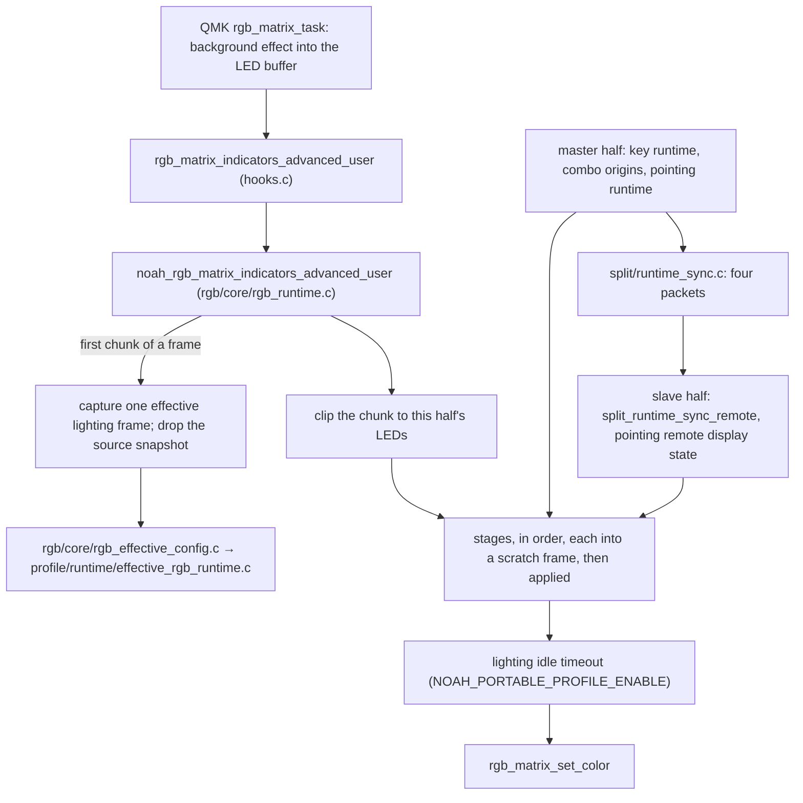

# The lighting render, from runtime state to the LEDs

How lighting reaches the LEDs on each half: where every stage's truth comes
from, how the slave half gets it, and who owns what. What the stages draw and
in which order, which localities, precedence and timings an author can rely
on, is the contract in [rgb-domain-v1.md](../spec/rgb-domain-v1.md#drawing);
the packets and their cadence are
[split-activity-sync.md](../spec/split-activity-sync.md#runtime-state-packets).
How a stage is written is [`rgb/README.md`](../../users/noah/lib/rgb/README.md).

The rule: **lighting renders, split sync mirrors, neither owns.** Every fact a
stage draws belongs to another module; the master half computes it, the slave
half receives the computed result, and both run the same stages over it.

## The path

QMK calls the hook once per LED chunk. `rgb_runtime_range_starts_frame`
detects a frame's first chunk; there the render drops its source snapshot and
captures one effective lighting frame (`noah_effective_rgb_frame_t`) that
every stage of every chunk in that frame reads. `rgb_runtime_normalize_local_range` clips the range to the half's own
LEDs (`RGB_MATRIX_SPLIT`), so each half draws only itself. Returning without
painting leaves QMK's background effect.

## The lighting view

`profile_owner.c` registers `noah_effective_rgb_runtime_invalidate` among the
active profile's invalidators ([profile-flow.md](profile-flow.md)). Each
activation, on each half, publishes into a double bank under a
`state/shared/runtime_publication.h` generation: the validated view of the
active profile's lighting domain, or the compiled view
(`profile_rgb_compiled_v1.c`) when the profile has none.

- `rgb_effective_config.c` is the stages' only reader. Every accessor checks
  the captured frame is still current and its stage bit is set, and reads one
  record. Without an installed runtime (narrow host and feature builds) its
  weak fallbacks serve the compiled view.
- Each stage asks `rgb_effective_config_frame_current` after painting and
  clears its scratch frame if a newer generation was published meanwhile, so
  a frame never shows two profiles.
- The mapped-only key map (`rgb_layer_stage.c`) rebuilds when
  `noah_effective_rgb_publication_epoch` moves, since the keymap changed with
  the profile.
- The key runtime reads the tap-commit policy through the same view
  (`key_feedback_tap_commit_mode` in `rgb_effective_config.c`), and a stale
  or busy read is off.

## Stages and their truth

| Order | Stage | Code | Master half reads | Slave half reads |
| ---: | --- | --- | --- | --- |
| 0 | boot indicator | `rgb_runtime.c` | `noah_runtime_diag_indicator_active` (`state/diagnostics/runtime_diag.c`) | the same, its own boot |
| 1 | layer | `stages/rgb_layer_stage.c` | `layer_state` | `layer_state`, mirrored by QMK (`SPLIT_LAYER_STATE_ENABLE`) |
| 1 | auto-mouse fade, instead | `automouse/rgb_automouse_stage.c`, `rgb_automouse.c` | QMK's auto-mouse timer through `compat/qmk_auto_mouse_contract.h` | base packet's quantized progress |
| 2 | combo, beneath | `stages/rgb_combo_feedback_stage.c` | `combo_feedback_bitmaps` (`key/runtime/feedback.c`) | combo packet |
| 3 | layer preview | `stages/rgb_preview_stage.c` | `key_feedback_preview_layer` (`feedback.c`) | base packet's preview layer |
| 4 | pointing mode | `stages/rgb_pd_mode_stage.c` | `pd_mode_snapshot_with_owner_bitmap` (`pointing/runtime/pd_mode_snapshot.c`), local state | the same, remote display state the base packet applied |
| 5 | combo, above | `stages/rgb_combo_feedback_stage.c` | as 2 | as 2 |
| 6 | key feedback | `stages/rgb_key_feedback_stage.c` | the four maps from `feedback.c` | semantic and branch packets |
| 7 | idle timeout, only under `NOAH_PORTABLE_PROFILE_ENABLE` (the write path) | `rgb_runtime_render_range` (`rgb_runtime.c`) | `last_input_activity_elapsed` against the lighting idle timeout setting | the same; QMK mirrors activity |

- `combo_feedback_bitmaps` partitions QMK's active combos through
  `noah_qmk_combo_origin_active_bitmaps_partitioned`
  (`compat/qmk_combo_origin.c`): a combo whose owner key is the preview owner
  or the pointing mode's owner goes beneath; one whose owner holds a
  momentary layer (`layer_ownership_momentary_owner_bitmap`) is left out of
  both but stays registered, so its release still finds its owner.
- `key_feedback_preview_layer` keeps showing the previewed layer for
  `KEY_FEEDBACK_PREVIEW_DISPLAY_BRIDGE_MS` (20 ms) after the preview ends if
  that layer is now on, so the handoff to the layer stage does not flicker.
- Both halves drop a pending tap-branch semantic on keys either combo bitmap
  covers (`rgb_runtime_render_snapshot_suppress_combo_tap_branch_semantics`):
  the key-feedback packets can lag the combo packet.

## Who owns which fact

| Fact | Owner | Lighting reads it through |
| --- | --- | --- |
| The lighting profile | the active profile (`profile/runtime/`) | `rgb_effective_config.c` |
| Layers that are on | `state/ownership/layer_ownership.c`, QMK `layer_state` | `layer_state` |
| Active combos, owner keys, footprints | `compat/qmk_combo_origin.c`, `key/runtime/slot/origin_registry.c` | `combo_feedback_bitmaps` |
| Presses, tap series, leases, pulses | `key/runtime/reducer/` (`key_runtime_core_state_t`) | `feedback.c`, which derives the maps on demand |
| Running and locked pointing mode, its owner | `pointing/runtime/pd_mode_state.c` | `pd_mode_snapshot_with_owner_bitmap` |
| Auto-mouse timer | QMK | `compat/qmk_auto_mouse_contract.h` |
| Last input | QMK, mirrored by split activity | `last_input_activity_elapsed` |

A new visible state is a semantic in `feedback.c` with its priority, never a
rule in a stage; a new mirrored fact is read from its owner by the packet
builder, never kept by split sync.

## Key feedback across the runtime

`feedback.c` keeps no state of its own: the preview bridge lives in
`key_runtime_core_state_t` (`preview_display_*`). Reading feedback still
changes that state: `key_feedback_preview_layer` starts and ends the bridge,
and `key_feedback_pulse_active` expires a pulse and starts the queued one, so
a queued pulse starts only when something reads feedback. It reads the
reducer and builds four maps on each call: the semantic map (a state per key), the tap
branch map, the newest-owner map (per surface: everywhere, each half, each
semantic) and the flash-visibility bitmap. Each owner's state is spread over
its footprint from `key_origin_registry_get_bitmap`, so a combo output
lights all its keys.

- **Tap phase.** `key_feedback_tap_series_shows_tap_branch`: the series is
  active, past tap count 1, its branch authors a step and it has not
  resolved. Both edges are reducer events, the tap that counts into the
  branch and the series resolving, so no display clock exists to disagree
  with the engine. The branch map carries the series' tap count, which the
  reducer sets from the resolved branch.
- **Action phase.** A branch resolves where it is decided, with no window
  between deciding and doing: the tap-series flush when the multi tap window
  closes (`planning/tap_series_flush.c`), the hold and long hold thresholds
  (`planning/scan_planner.c`), a release (`planning/release_planner.c`,
  `reducer/runtime.c`). Each pushes `KEY_RUNTIME_EFFECT_FEEDBACK_PULSE` into
  the effect plan; `projection/feedback_projection.c` sets the pulse, or
  queues one behind a running pulse. Tap-commit pulses pass
  `key_runtime_core_tap_commit_feedback_allowed` (`planning/effect_plan.c`)
  first.
- **Tiers.** `key_feedback_semantic_for_token` reads the press token's phase,
  the held action and repeat lease at its position, and time since the press
  against the branch's thresholds; `key_feedback_semantic_priority` decides
  between states on one key.
- **Flash phase.** `key_runtime_core_flashing_feedback_visible_at`
  (`reducer/ownership_state.c`) times each lease from its own start. The
  master half sends the resulting bitmap, so the slave half flashes in the
  master half's phase rather than its own clock.
- **Newest.** Each activation takes a `feedback_sequence`; the owner map keeps
  the latest per surface, compared across wrap.
- **Dirty.** `transition.c` marks key feedback dirty for a non-empty plan, or
  an empty one that moved the feedback mark; `feedback_projection.c` on every
  pulse; `qmk_combo_origin.c` marks combos dirty. One mark covers both
  key-feedback packets, so the owner map cannot lag the semantic map.

## How the slave half gets it

1. `noah_matrix_scan_user` (`runtime_init.c`) runs, on the master half, the
   key runtime scan and then `split_runtime_sync_tick`. One `timer_read32`
   serves the whole pass: scheduling, every domain's last-sent time.
2. The tick builds the base and combo packets every pass and the key-feedback
   packets when dirty, forced, last sent active, or heartbeat due; it sends
   base, combo, semantic, branch in that order, stopping at the first failure.
   A domain's dirty flag and last-sent copy change only after it succeeds.
   Fade progress is read from QMK's timer whenever auto-mouse is on, not only
   while the pointer moves, because the fade runs after movement stops.
3. On the slave half the RPC callbacks run in QMK's split worker thread,
   which can preempt the main loop. Each publishes its domain into
   `split_runtime_sync_remote` between `noah_runtime_publication_begin` and
   `_end`; the base callback also hands the pointing identity to the pointing
   runtime (`pd_mode_apply_remote_mode_ids_with_owner_bitmap`).
4. At a frame's first use, the render copies the combo and key-feedback
   domains into `rgb_runtime_render_snapshot` through
   `split_runtime_sync_remote_read_*`; a read that meets a publication keeps
   the previous copy. Semantic and branch are separate generations, so one
   frame can pair maps one packet apart.

The halves therefore differ only in freshness, never in rules: the slave half
evaluates no feedback rule. What is not mirrored here: the lighting profile
(each half runs its own converged active profile,
[profile-split-v1.md](../spec/profile-split-v1.md)), layer state and activity
timestamps (QMK's split sync, the latter coalesced).

## Changing it

| Change | Where | Not in |
| --- | --- | --- |
| Colours, groups, localities in the compiled defaults | the profile's `rgb_config.c` | stage code |
| Stage order or what a stage draws | `rgb/core/rgb_runtime.c`, `rgb/stages/`, `rgb/automouse/`, with [rgb-domain-v1.md](../spec/rgb-domain-v1.md#drawing) | the authored tables |
| A feedback state or its timing | `key/runtime/feedback.c`, the planners for pulses | lighting stages, split sync |
| A mirrored field | the packet in `split/runtime_sync.h` (each fits `RPC_M2S_BUFFER_SIZE`), its builder, slave callback and reader, with [split-activity-sync.md](../spec/split-activity-sync.md#runtime-state-packets) | the owner's module |

## Tests that hold it

- `run_rgb_layer_render_tests.sh`: the stages and their order on both halves,
  remote snapshots, localities, newest owner, auto-mouse fade, chunked frames,
  the idle timeout.
- `run_effective_rgb_runtime_tests.sh`: the double bank, stale frames.
- `run_rgb_validation_tests.sh`, `run_profile_rgb_v1_tests.sh`,
  `run_profile_rgb_v4_tests.sh`: the lighting domain and authored tables.
- `run_runtime_debug_tests.sh`, `run_tap_depth_eight_tests.sh`: the
  key-feedback maps against the reducer, pulses, the preview bridge.
- `run_qmk_combo_origin_tests.sh`: combo partitioning and the left-out
  momentary-layer owner.
- `run_split_runtime_sync_tests.sh`: packet building, dirty gating,
  heartbeats, backoff, atomic publication to readers.
- `run_runtime_trace_tests.sh`: split sync trace events.
- `run_real_profile_validation_tests.sh`: the real profile's lighting.
