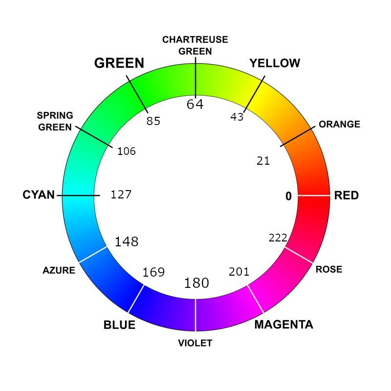

# Authoring in C

With Ark you never need this page. But the **compiled defaults**, what a
keyboard with nothing saved runs, are plain data in C, and you can write
your own and build a pair from them.

The authored profile lives in
[`keyboards/bastardkb/charybdis/4x6/keymaps/noah/`](../../keyboards/bastardkb/charybdis/4x6/keymaps/noah/):

| File | What it holds |
| --- | --- |
| [`keymap.c`](../../keyboards/bastardkb/charybdis/4x6/keymaps/noah/keymap.c) | layers and their names, custom keys, macros, combos and behaviours |
| [`config.h`](../../keyboards/bastardkb/charybdis/4x6/keymaps/noah/config.h) | the layer list, timings, pointer and lighting settings, host and name |
| [`rgb_config.c`](../../keyboards/bastardkb/charybdis/4x6/keymaps/noah/rgb_config.c) | lighting: layer, pointing-mode and feedback colours, LED groups |
| [`pd_config.c`](../../keyboards/bastardkb/charybdis/4x6/keymaps/noah/pd_config.c) | the 32 pointing slots |
| `authored_macro_bank.h` | generated from the macros; never edited by hand |

The runtime under [`users/noah/`](../../users/noah/) is generic: it holds no
names, timings or colours of mine, and you shouldn't need to touch it.

Flashing a pair with different compiled defaults, even one colour changed,
starts the keyboard from them: a saved profile is used only by firmware with
the same compiled defaults
([Installing](installing.md#what-happens-to-your-profile)). Back up in Ark
first and restore the backup afterwards.

## `keymap.c`

### Layers

`keymaps[][]` holds one `LAYOUT(...)` per layer, indexed by the layer names
in `config.h` (`LAYER_BASE`, `LAYER_NUM`…). There are always 16 layers; the
unused ones are transparent. `_______` is transparent and `XXXXXXX` does
nothing. `layer_names[]` gives each layer the name Ark shows, at most 32
bytes.

Layer keys work as in [What keys can do](keys.md#layer-keys). `DF()` and
`PDF()` fail the build. For a layer that sits under the others, such as a
game layer, order it just above the base layer and reach it with `TO()`.

### Custom keys

`CUSTOM_KEYS(KEY, SHORTCUT)` lists all 128 custom keys, one row each:

```c
#define CUSTOM_KEYS(KEY, SHORTCUT)                                                                 \
    KEY(CUSTOM_KEY_0, "Right Thumb")                                                               \
    SHORTCUT(CUSTOM_KEY_4, "Hyper K", SHORTCUT_MODS(KC_LCTL, KC_RALT), KC_K, SHORTCUT_NO_LAYERS)   \
    SHORTCUT(CUSTOM_KEY_5, "Cmd + Nav", SHORTCUT_MODS(KC_LGUI), KC_NO, SHORTCUT_LAYERS(LAYER_NAV)) \
    KEY(CUSTOM_KEY_6, "")                                                                          \
    ...
```

A name is at most 32 bytes; `""` leaves the slot unused. Name the modifier
keys in `SHORTCUT_MODS(...)`, or write `SHORTCUT_NO_MODS`; a QMK `MOD_*`
constant doesn't compile, since `MOD_RALT` would mean other keys here. The
key is a basic key (`KC_A` to `KC_EXSEL`), a mouse button (`MS_BTN1` to
`MS_BTN8`) or `KC_NO` for none. Name the layers it holds on in
`SHORTCUT_LAYERS(...)`, any of layers 1 to 15, or write `SHORTCUT_NO_LAYERS`;
the base layer is always on, so it doesn't compile, and a profile whose default
layers include one a shortcut names is refused. To act on the layers as
another layer key does, all of them together, name them in
`SHORTCUT_LOCK_LAYERS(...)` (`TG()`), `SHORTCUT_MOVE_TO_LAYERS(...)` (`TO()`),
`SHORTCUT_TAP_TOGGLE_LAYERS(...)` (`TT()`) or `SHORTCUT_ONESHOT_LAYERS(...)`
(`OSL()`) instead ([keys](keys.md#custom-keys)); one row takes one of these
forms, never two. A row holds at least one of the three.

### Macros

`MACROS(MACRO)` lists all 128 macros as
`MACRO(MACRO_n, "name", "payload")`. In the payload:

- plain text is typed as it stands: `hello`;
- `{KC_A}` taps a key and `{KC_LGUI,KC_SPC}` a chord;
- `{+KC_LGUI}` presses a key and `{-KC_LGUI}` releases it; every press needs
  its release, in the same macro;
- `{250}` waits 250 ms.

```c
MACRO(MACRO_10, "Select All + Copy", "{KC_LGUI,KC_A}{50}{KC_LGUI,KC_C}")
```

After changing the macros, regenerate `authored_macro_bank.h`:

```sh NOAH_WRITE_AUTHORED_MACRO_BANK=1 sh
tests/host/run_real_profile_validation_tests.sh ```

A stale copy fails the build. Authored macros play uninterruptibly only when
they need Unicode entry ([Macros](macros.md#uninterruptible-playback)).

### Combos

`COMBOS(COMBO, COMBO_WINDOW)` lists the combos:

```c
#define COMBOS(COMBO, COMBO_WINDOW)                                       \
    COMBO(KC_TAB, (KC_D, LT(LAYER_NAV, KC_F)))                            \
    COMBO_WINDOW(KC_ESC, (KC_Q, KC_W), 30)
```

The keys go in parentheses, each one once. `COMBO` uses the window
`COMBO_TERM` in `config.h`; `COMBO_WINDOW` gives the combo its own, in ms.

### Behaviours

`key_behaviors[]` holds one row per keycode. This is my right thumb key:

```c
{
    .keycode = CUSTOM_KEY_0, // "Right Thumb"
    .tap_counts = {
        // tap: lock Navigation; hold: Navigation while held
        [0] = { .tap  = TAP_SENDS(LOCK_LAYER(LAYER_NAV)),
                .hold = PRESS_AND_HOLD_UNTIL_RELEASE(MO(LAYER_NAV)) },
        // double tap: play/pause; hold: Esc; long hold: lock Number
        [1] = { .tap       = TAP_SENDS(KC_MPLY),
                .hold      = TAP_ON_RELEASE_AFTER_HOLD(KC_ESCAPE),
                .long_hold = TAP_AT_HOLD_THRESHOLD(LOCK_LAYER(LAYER_NUM)) },
        // triple tap: next track
        [2] = { .tap = TAP_SENDS(KC_MNXT) },
    },
},
```

- `.tap_counts[0]` to `[4]` are the single to quintuple tap, each with
  `.tap`, `.hold` and `.long_hold`. Leave out what you don't need.
- A tap is `TAP_SENDS(action)`. A hold or long hold takes its
  [hold style](keys.md#tap-hold-and-long-hold):
  `PRESS_AND_HOLD_UNTIL_RELEASE(action)`, `TAP_AT_HOLD_THRESHOLD(action)`,
  `TAP_ON_RELEASE_AFTER_HOLD(action)` or `REPEAT_WHILE_HELD(action, hz)`.
- `KC_TRNS` as the action takes what the layer below does at this key for
  the same tier, while this row keeps its own timing and tap counts.
- `.tap_hold_term`, `.longer_hold_term` and `.multi_tap_term` set this row's
  timing in ms; left out, it follows `config.h`.
- `.keeps_auto_mouse_anchored = true` makes the key count as a mouse key, so
  pressing it keeps the pointer layer on. Mouse keys and pointing keys don't
  need it; a key that drives the mouse through its behaviour does, or the
  press turns the pointer layer off.

A row with no tap counts does nothing. Where an action may go is in
[What keys can do](keys.md#layer-keys); the build refuses anything else.

### What C can't say

The participation switches, each combo's "use output behaviour" switch and a
macro's uninterruptible setting are set only from Ark. The compiled defaults
let every behaviour and combo run everywhere, and combos use their output's
behaviour.

## `config.h`

- **Layers**: the `LAYER_*` names. Rename them or use the spare
  `LAYER_EXTRA_*` ones; there are always 16.
- **Timing**: `TAPPING_TERM` (dual-role keys), `CUSTOM_TAP_HOLD_TERM`,
  `CUSTOM_LONGER_HOLD_TERM`, `CUSTOM_MULTI_TAP_TERM`, `COMBO_TERM`.
- **Pointing**: the DPI ladders, `CHARYBDIS_AUTO_SNIPING_LAYER`,
  `AUTO_MOUSE_DEFAULT_LAYER` and `AUTO_MOUSE_TIME`.
- **Lighting**: `RGB_MATRIX_MAXIMUM_BRIGHTNESS` (the limit no colour may
  pass), the background effect, `NOAH_RGB_IDLE_TIMEOUT_MS`, the key feedback
  flash interval and the auto-mouse fade's hold, `AUTOMOUSE_RGB_DEAD_TIME`,
  which must stay below `AUTO_MOUSE_TIME`. Comment out
  `RGB_POINTING_MODE_FEEDBACK_ENABLE`, `RGB_COMBO_FEEDBACK_ENABLE`,
  `RGB_KEY_BEHAVIOR_FEEDBACK_ENABLE` (which takes the layer preview with it)
  or `RGB_AUTOMOUSE_GRADIENT_ENABLE` to leave that stage out of the build.
- **Host**: `NOAH_DEFAULT_HOST_OS` (0 Auto, 1 macOS, 2 Windows, 3 Linux),
  `NOAH_DEFAULT_HOST_LAYOUT` (an id from the
  [host layouts](../spec/host-layouts-v1.md#catalogue)),
  `NOAH_DEFAULT_UNICODE_PLAYBACK` and `NOAH_DEFAULT_MACOS_ISO`.
- **Name**: `NOAH_KEYBOARD_NAME`, at most 32 bytes; empty keeps QMK's name.

A value here is only the compiled default; a saved profile keeps its own.
To change a QMK value, `#undef` it, then `#define` it.

## `rgb_config.c`

The lighting tables follow [Lighting](lighting.md), in the order they paint.
Colours are `HSV(hue, saturation, value)`, each 0 to 255:



- `layer_colors[]`: one row per layer, `.color` and `.mode` (`ALL_KEYS` or
  `KEYS_MAPPED_ON_THIS_LAYER_ONLY`). `HSV(0, 0, 0)` is no colour.
- `RGB_LED_GROUP(...)` names LEDs by the map at the top of the file;
  `layer_led_groups_data`, `pointing_mode_led_groups_data`,
  `combo_feedback_led_groups_data` and `key_behavior_feedback_led_groups_data`
  paint them per layer, pointing mode or kind of feedback, with
  `RGB_LAYER_GROUP_ALL`, `RGB_POINTING_MODE_GROUP_ALL` and
  `KEY_FEEDBACK_GROUP_ALL` for all of them. In a group row, `HSV(0, 0, 0)` takes
  the stage's colour. `saved_led_groups_data` keeps groups no stage uses yet,
  for Ark to offer.
- `automouse_fade_end_config`: `FOLLOW_REAL_DESTINATION`,
  `END_COLOR_WHERE_BASE_EFFECT_WOULD_SHOW` or `END_COLOR_ON_ALL_KEYS`, and
  the `end_color`.
- `pointing_mode_colors[]`: a colour and `.locality` for every pointing slot
  (`POINTING_MODE_DRAGSCROLL`… `POINTING_MODE_PINCH`, then
  `POINTING_MODE_SLOT_6` to `_31`).
- `combo_feedback_colors` and `key_behavior_feedback_colors`: the colours,
  `.tap_commit_mode` (`KEY_FEEDBACK_TAP_COMMIT_OFF` or
  `KEY_FEEDBACK_TAP_COMMIT_NON_BASE_TAPS`) and `.locality`.

Locality is `RGB_BOTH_HALVES`, `RGB_LEFT_HALF`, `RGB_RIGHT_HALF`,
`RGB_KEY_HALF` or `RGB_KEYS_ONLY`. Keep `MATERIALIZE_RGB_CONFIG();` at the
bottom.

## `pd_config.c`: adding a pointing mode

`noah_pd_defaults[]` has one record per slot, all 32 in order. To add a mode,
fill an empty slot's record and give it a name; then place `PD_SLOT_n` or
`PD_SLOT_n_LOCK` in the keymap and give it a colour in `pointing_mode_colors[]`.

```c
{.id=6, .name="Undo / Redo", .kind=1, .axis=1, .dpi=100, .threshold_x=40,
 .directions={{G(KC_Z),0,0}, {S(G(KC_Z)),0,0}}},
```

- `.kind`: 1 directional, 2 scrolling (0 empty).
- `.axis`, directional: 0 vertical, 1 horizontal, 2 dominant axis, 3 eight
  directions. Scrolling: 0 both, 1 horizontal only, 2 vertical only.
- `.dpi`: the pointer speed while it runs; 0 keeps the normal speed.
- `.pointer_layer`: 0 keeps the pointer layer on, 1 gives way to the typing
  layer.
- Directional: `.threshold_x` and `.threshold_y` (sensor counts per step),
  `.directions` (left, right, up, down) and, for eight directions,
  `.diagonals` (up-left, up-right, down-left, down-right). Each is
  `{action, policy, mask}`: policy 0 adds the modifiers you hold, 1 leaves
  out those in `mask`, 2 sends the action alone. An action is a key, a
  shortcut, `MS_BTN1` to `MS_BTN8` or a macro; a macro takes policy 0 and
  mask 0. `.direction_output =
  NOAH_PD_DIRECTION_OUTPUT_ONCE` sends once per movement.
- The link ([linked layers](pointing.md#linked-layers)): `.linked_layers`,
  a mask of the layers that start the mode (`1u << NAV`); `.link_turns_on`, a
  mask of the layers its key turns on; and `.link_ends`,
  `NOAH_PD_LINK_ENDS_HIGHER_LAYER` or `NOAH_PD_LINK_ENDS_OTHER_LAYER`, what
  ends a mode its layers started. Leave them out for no link. Mouse buttons 1 to 3 keep their own behaviour in every
  mode; a layer the link turns on gives a mode keys of its own.
- Scrolling: `.held_modifiers` held while it scrolls, and the scroll tuning;
  `SCROLL_TUNING`, as Dragscroll uses it, gives the defaults.

The constant names (`NOAH_PD_KIND_SCROLLING`, `NOAH_PD_AXIS_EIGHT`…) are in
[`profile_pd_v1.h`](../../users/noah/lib/profile/schema/profile_pd_v1.h), and
the [pointing contract](../spec/pd-mode-domain-v1.md) holds every field. A
33rd slot, or a new kind of movement, is a change to the firmware, not to
the profile.

## Building the pair

The firmware you flash is the side-specific pair. A plain `qmk compile`
builds a generic image that can't store a profile.

1. Install and start Docker.
2. Check out my [BK QMK fork](https://github.com/NoahCLR/bastardkb-qmk)
   beside this repository, at the commit [`qmk-pin.json`](../../qmk-pin.json)
   names, or point `QMK_ROOT` at it.
3. Run `sh tools/build-firmware-pair.sh`.

It builds both halves in the same Docker image releases are built in and
writes them to `../builds/<branch>/` (or `BUILD_ROOT`) as
`<n>_charybdis_left.uf2` and `<n>_charybdis_right.uf2`, with a note of what
they were built from. Every build also validates the authored profile: a
misplaced action, a stale macro bank or a bad colour fails it.

[Development](../development.md) has the details, and
[Hook overrides](hooks.md) is for adding code of your own.
